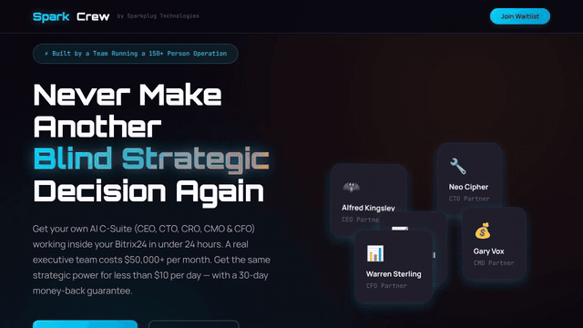
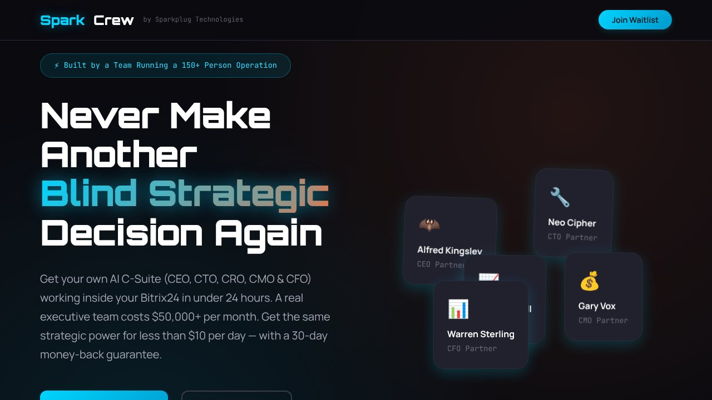
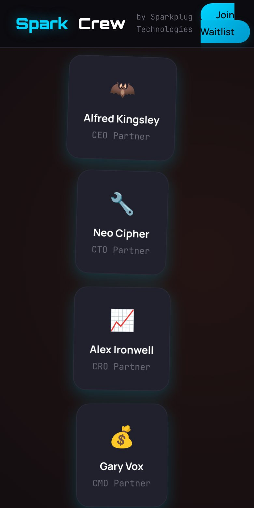

# SparkCrew · landing

[English](./README.md) · **Español**

> Landing y lista de espera de SparkCrew, un experimento de producto de Sparkplug Technologies.

**[▶ Visitar SparkCrew](https://sparkcrew.jorgesuarez.com.mx)** · Sparkplug Technologies

<p align="center"></p>
<p align="center"><sub>Recorrido real del sitio en vivo, grabado el 10 nov 2026 en Chromium (1280×720). Sin retoque. <a href="docs/readme/tour.mp4">Ver el video MP4</a></sub></p>

## ¿Qué es?

La landing pública y la lista de espera de **SparkCrew**, un experimento de producto de [Sparkplug Technologies](https://getsparkplug.com). Este repo contiene la landing, no el producto.

## ¿Para quién es?

Para dueños y directores de PyMEs que ya trabajan en Bitrix24 y quieren conocer la propuesta.

## ¿Qué dolor resuelve?

Una PyME toma decisiones de estrategia, tecnología, ventas, marketing y finanzas sin tener un equipo directivo completo para cada área.

## La propuesta

Explorar una idea concreta: llevar un equipo de partners de IA, con roles directivos, al espacio de trabajo de la empresa en Bitrix24.

| Rol | Enfoque |
|---|---|
| CEO Partner | Decisiones y dirección estratégica |
| CTO Partner | Arquitectura y estrategia tecnológica |
| CRO Partner | Ventas, oferta y crecimiento de ingresos |
| CMO Partner | Marketing y adquisición |
| CFO Partner | Planeación y claridad financiera |

## ¿Cómo se usa?

1. Abre [sparkcrew.jorgesuarez.com.mx](https://sparkcrew.jorgesuarez.com.mx).
2. Lee la propuesta y conoce los perfiles del crew.
3. Si te interesa, déjanos tus datos en la lista de espera.

## ¿Cuándo conviene y cuándo no?

Conviene para conocer la idea y apuntarte.

Es una propuesta, no un servicio contratado ni una prueba del producto funcionando. La landing está en inglés.

## ¿Dónde lo pruebo?

En vivo: **[sparkcrew.jorgesuarez.com.mx](https://sparkcrew.jorgesuarez.com.mx)**

<p align="center">
  
  
</p>
<p align="center"><sub>Capturas reales del sitio en vivo, 10 nov 2026: escritorio (1280×720) y móvil (390×780).</sub></p>

## Hasta dónde llegamos

Landing pública con flujo de lista de espera y página de confirmación. El producto no vive en este repo.

## Para quien construye

HTML, CSS y JavaScript sin framework. El formulario usa Formspree.

```bash
git clone https://github.com/jorgefsb/sparkcrew-landing.git
cd sparkcrew-landing
python3 -m http.server 3000
```

| Archivo | Qué es |
|---|---|
| `index.html` | Landing principal |
| `thank-you.html` | Confirmación de la lista de espera |
| `style.css` | Sistema visual y responsive |
| `script.js` | Interacciones y animación |
| `CNAME` | Dominio público |

## Marca y créditos

SparkCrew es un experimento de producto de [Sparkplug Technologies](https://getsparkplug.com) y usa su identidad, no la marca personal de Jorge Suárez.

---

<div align="center">

<sub>Repositorio mantenido por <a href="https://github.com/jorgefsb">Jorge Suárez</a> · <a href="./README.md">Read in English</a> · Documentación actualizada el 10 nov 2026.</sub>

</div>
