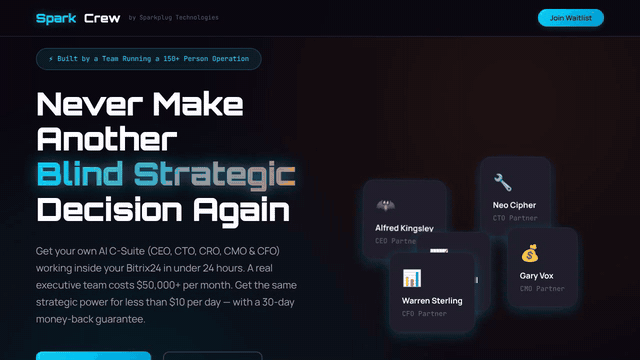
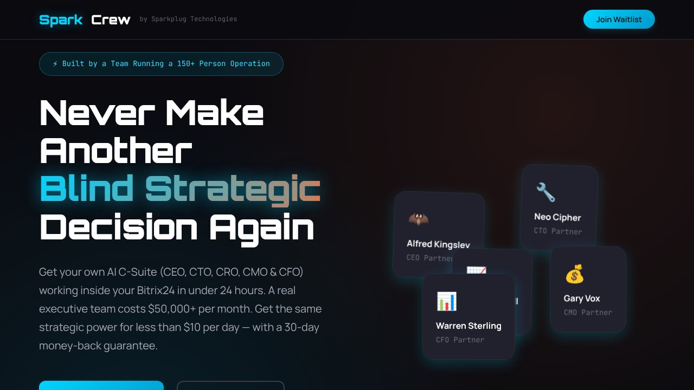
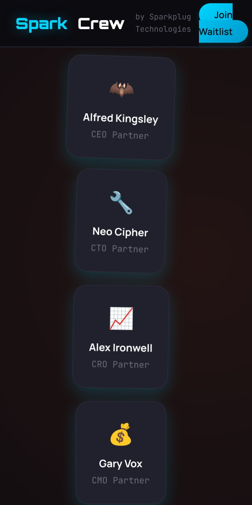

# SparkCrew · landing

**English** · [Español](./README.es.md)

> Landing page and waitlist for SparkCrew, a product experiment by Sparkplug Technologies.

**[▶ Visit SparkCrew](https://sparkcrew.jorgesuarez.com.mx)** · Sparkplug Technologies

<p align="center"></p>
<p align="center"><sub>Real walkthrough of the live site, recorded 10 Nov 2026 in Chromium (1280×720). No retouching. It plays once; reload the page to watch it again. <a href="docs/readme/tour.mp4">Watch the MP4 video</a></sub></p>

## What is it?

The public landing page and waitlist for **SparkCrew**, a product experiment by [Sparkplug Technologies](https://getsparkplug.com). This repo holds the landing page, not the product.

## Who is it for?

For owners and directors of small businesses who already work in Bitrix24 and want to learn about the proposal.

## What pain does it solve?

A small business makes strategy, technology, sales, marketing and finance decisions without a full leadership team for each area.

## The proposal

Explore one concrete idea: bring a team of AI partners, with leadership roles, into the company's Bitrix24 workspace.

| Role | Focus |
|---|---|
| CEO Partner | Decisions and strategic direction |
| CTO Partner | Architecture and technology strategy |
| CRO Partner | Sales, offer and revenue growth |
| CMO Partner | Marketing and acquisition |
| CFO Partner | Planning and financial clarity |

## How do I use it?

1. Open [sparkcrew.jorgesuarez.com.mx](https://sparkcrew.jorgesuarez.com.mx).
2. Read the proposal and meet the crew profiles.
3. If you are interested, leave your details on the waitlist.

## When it fits and when it doesn't

It fits for learning about the idea and signing up.

It is a proposal, not a contracted service or proof of a working product.

## Where can I try it?

Live: **[sparkcrew.jorgesuarez.com.mx](https://sparkcrew.jorgesuarez.com.mx)**

<p align="center">
  
  
</p>
<p align="center"><sub>Real screenshots of the live site, 10 Nov 2026: desktop (1280×720) and mobile (390×780).</sub></p>

## How far we got

A public landing page with a waitlist flow and a confirmation page. The product does not live in this repo.

## For builders

Framework-free HTML, CSS and JavaScript. The form uses Formspree.

```bash
git clone https://github.com/jorgefsb/sparkcrew-landing.git
cd sparkcrew-landing
python3 -m http.server 3000
```

| File | What it is |
|---|---|
| `index.html` | Main landing page |
| `thank-you.html` | Waitlist confirmation |
| `style.css` | Visual system and responsive layout |
| `script.js` | Interactions and animation |
| `CNAME` | Public domain |

## Brand and credits

SparkCrew is a product experiment by [Sparkplug Technologies](https://getsparkplug.com) and uses its identity, not Jorge Suárez's personal brand.

---

<div align="center">

<sub>Repository maintained by <a href="https://github.com/jorgefsb">Jorge Suárez</a> · <a href="./README.es.md">Leer en español</a> · Documentation updated on 10 Nov 2026.</sub>

</div>
